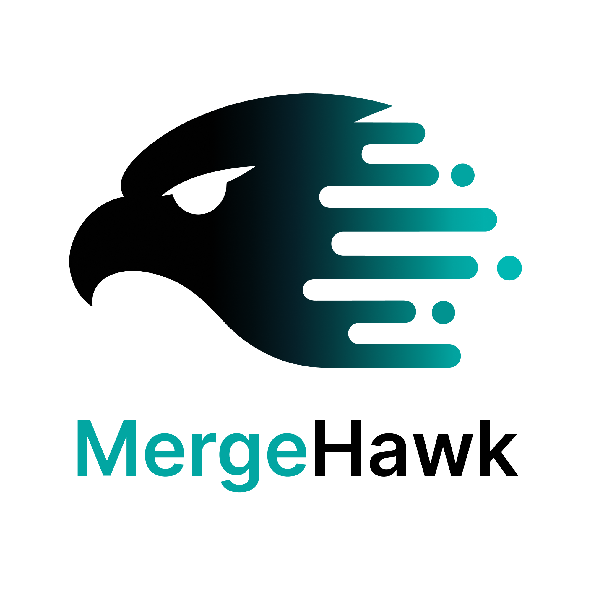

  

  <strong>Eyes on the pull requests that matter to you.</strong> 
  A free macOS menu bar app for GitHub pull requests.

  <a href="https://github.com/robinwettstaedt/mergehawk/releases/latest"><strong>Download for Mac</strong></a>
  ·
  <a href="https://mergehawk.dev">mergehawk.dev</a>

MergeHawk shows the PRs you opened and the ones waiting on your review, one line each. It
notifies you about the updates you pick (reviews, CI failures, mentions) and skips the rest.

## Requirements

- A Mac with Apple Silicon
- macOS 14 Sonoma or later
- A GitHub.com account (GitHub Enterprise Server, GitLab and Bitbucket are not supported)

## Features

- **Authored, Requested and Notifications tabs.** Your open PRs, the PRs assigned to you or
  waiting on your review, and a running list of what changed. Switch with ⌘1, ⌘2 and ⌘3.
- **Everything on one line.** Lines changed, unresolved threads, CI, merge conflicts, review
  status and age. An approval from before the newest push does not show as green when your
  repo requires approval of the latest push.
- **Notifications by involvement.** Choose updates separately for PRs you authored, PRs
  assigned to you, direct review requests and team review requests.
- **Straight to the comment.** Notifications open GitHub at the exact comment or review, and
  reuse an open browser tab when the PR is already open.
- **Noise controls.** Turn off broad teams, mute repositories, owners and bots, hide
  archived repos, and pin or hide single PRs.
- **Stacks.** PRs you review that belong to a stack show as one expandable card.
- **A quiet first run.** The first sync records what is already there, so day one does not
  start with a pile of notifications.

## Install

1. Download the latest DMG from
   [Releases](https://github.com/robinwettstaedt/mergehawk/releases/latest).
2. Open it and drag MergeHawk into Applications.
3. Open MergeHawk. It appears in your menu bar, with no Dock icon.

## Get started

1. **Sign in with GitHub.** MergeHawk shows a code. Enter it on github.com to confirm. Your
   password never goes through MergeHawk.
2. **Choose your repositories.** Install the MergeHawk GitHub App on all of your repositories
   or only the ones you pick. For organization repositories, an organization owner (or a
   repository admin, if the organization allows it) needs to install or approve the app.

If your organization restricts GitHub Apps, open Settings, then Auth, and connect with a
personal access token instead.

## Privacy and permissions

- **Read-only.** MergeHawk requests read access to repository metadata, pull requests,
  issues, checks and commit statuses, plus organization membership so it can see your
  teams. It never writes to your GitHub account.
- **Only where you allow it.** It sees repositories where you installed the MergeHawk
  GitHub App.
- **Stays on your Mac.** Credentials are stored in the macOS Keychain. Preferences and
  notification history are stored locally.
- **No MergeHawk server.** The app talks directly to GitHub. No analytics, no tracking.

MergeHawk checks GitHub every 2 minutes by default. You can set the interval between 1 and 15
minutes in Settings.

## Updates

MergeHawk checks for new versions every 6 hours, or on demand from Settings. Every build is
signed and notarized by Apple.

## Support

- Bugs and feature requests: [open an issue](https://github.com/robinwettstaedt/mergehawk/issues).
- Security issues: please report them privately as described in [SECURITY.md](SECURITY.md).
- Anything else: hello@mergehawk.dev

## Contributing and building from source

See [CONTRIBUTING.md](CONTRIBUTING.md) before opening a pull request. Build, run and test
instructions are in [docs/development.md](docs/development.md). The release pipeline is
described in [docs/releasing.md](docs/releasing.md).

## License

MergeHawk is released under the [MIT License](LICENSE).
